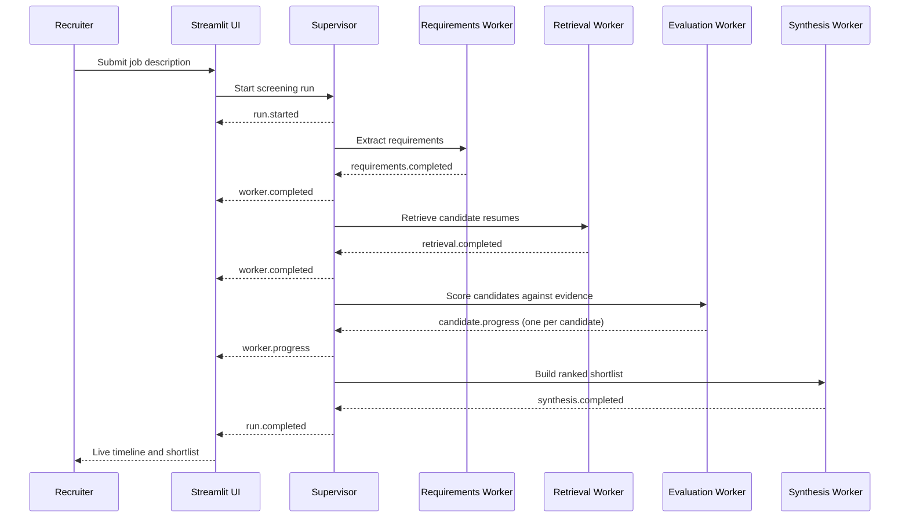
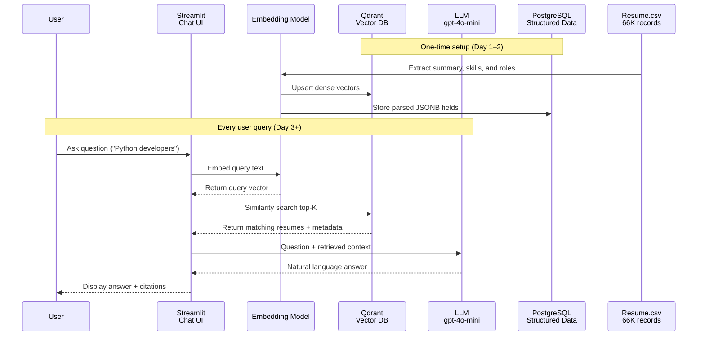
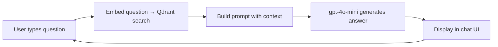

# Architecture Document: HR Assist — AI Resume Chatbot (RAG)

## 1. System Overview

HR Assist uses a supervisor-workers agent architecture. A supervisor coordinates
specialized workers for each screening request, while Streamlit displays the
supervisor and worker progress as a live event stream. Resume ingestion remains
a separate one-time pipeline.

### 1.1 Supervisor-workers runtime

The supervisor owns workflow state and delegates work; workers do not call one
another directly. Each worker returns a typed result and emits progress events.
This keeps the workflow observable and allows an individual worker to be
replaced without changing the UI.



#### Worker responsibilities

| Component | Responsibility | Output |
|-----------|----------------|--------|
| Supervisor | Validate the request, delegate workers, enforce ordering, aggregate results, and publish run status | Run state and stream events |
| Requirements worker | Extract required skills, seniority, category, and constraints from the job description | Normalized screening profile |
| Retrieval worker | Search Qdrant and fetch structured resume records from PostgreSQL | Ranked candidate set with retrieval scores |
| Evaluation worker | Compare each candidate with the screening profile and cite resume evidence | Per-candidate scorecard |
| Synthesis worker | Rank the evaluated candidates and explain the shortlist | Recruiter-ready shortlist |

Workers must treat the recruiter as the final decision-maker. A worker may
report uncertainty or missing evidence, but must not silently infer or invent
candidate qualifications.

### 1.2 Streaming event contract

The supervisor publishes events to the Streamlit session through a streaming
transport (Server-Sent Events for an HTTP API, or the equivalent Streamlit
generator for an in-process prototype). Every event contains:

```json
{
  "run_id": "screening-run-id",
  "sequence": 12,
  "agent": "evaluation-worker",
  "type": "worker.progress",
  "status": "running",
  "message": "Evaluated candidate 16852973",
  "data": {
    "candidate_id": "16852973",
    "completed": 3,
    "total": 10
  },
  "timestamp": "2026-10-24T15:30:00Z"
}
```

Required event types are `run.started`, `worker.started`,
`worker.progress`, `worker.completed`, `worker.failed`, `run.completed`, and
`run.failed`. Events are ordered by `sequence`; the UI must render an event
even when its `data` payload is empty.

### 1.3 Streaming UI behavior

The UI has two synchronized areas:

1. **Agent timeline:** shows the supervisor delegation chain, current worker,
   status icon, elapsed time, and the latest progress message. In-progress
   workers use a spinner; completed workers show a success state; failed
   workers show the error and recovery action.
2. **Results area:** remains visible while the run is in progress and updates
   as scorecards arrive. Candidate cards show match score, matched criteria,
   supporting resume evidence, and an uncertainty label.

The submit control is disabled for the active `run_id`. A reconnecting client
uses the last received `sequence` to resume the stream, and a completed run
can be reopened from its stored event history. The UI must show a clear
partial-results state when a worker fails instead of presenting partial output
as a completed shortlist.

### 1.4 Failure handling and observability

- The supervisor records the run state and last event sequence.
- A worker failure is emitted as `worker.failed` with a safe user-facing
  message and a diagnostic correlation ID.
- Retryable retrieval or LLM failures may be retried by the supervisor with
  bounded backoff; non-retryable failures stop dependent workers.
- Langfuse traces include the `run_id`, worker name, inputs, outputs, latency,
  token usage, and retrieved candidate IDs. PII must not be copied into
  application logs.
- The final response is only marked complete after synthesis finishes and all
  required worker results are accounted for.



**Query pattern:**

| Example Query | What happens |
|---------------|-------------|
| "Who has 5+ years Python experience?" | Embed → retrieve top-K → LLM answers based on extracted resume info |
| "Candidates in Finance with AWS skills" | Semantic search returns relevant docs → LLM formulates response |
| "Show resume for ID 16852973" | Direct PostgreSQL lookup → display structured JSONB fields |
| "Compare top 3 Python candidates for Senior Dev" | Search role match + LLM side-by-side comparison |

**Latency target:** < 3 seconds per query (retrieval < 50ms, LLM ~1–2s).

## 2. Technology Stack

| Component | Technology | Purpose |
|-----------|-----------|---------|
| **Database** | PostgreSQL | Structured resume data (JSONB), raw text, HTML archival |
| **Vector Database** | Qdrant | Dense vector similarity search over resume embeddings |
| **LLM Framework** | LangChain | Chains, retrievers, prompt templates, output parsing |
| **LLM** | OpenAI gpt-4o-mini | Natural language QA over retrieved resume context |
| **Embeddings** | OpenAI text-embedding-3-small | Resume document & query vectorization (1536-dim) |
| **Frontend** | Streamlit | Single-page chat interface for recruiters |
| **Observability** | Langfuse | Trace queries: input, retrieved documents, tokens, cost |

## 3. Data Architecture

### 3.1 PostgreSQL Schema

Minimal tables — resumes and nothing else at this stage:

```sql
CREATE TABLE resumes (
    id BIGINT PRIMARY KEY,
    raw_text TEXT,
    raw_html TEXT,
    category VARCHAR(100),
    parsed_data JSONB,           -- Structured extraction
    embedding_text TEXT,         -- Text used to generate the vector
    created_at TIMESTAMP DEFAULT NOW()
);

-- Inside parsed_data JSONB (example):
{
    "name": "John Doe",
    "contact": {"email": "...", "phone": "...", "location": "..."},
    "summary": "...",
    "experience": [
        {
            "title": "Software Engineer",
            "company": "Acme Corp",
            "start_date": "2020-01",
            "end_date": "2023-12",
            "responsibilities": ["...", "..."],
            "skills_used": ["Python", "AWS"]
        }
    ],
    "education": [
        {
            "degree": "B.S. Computer Science",
            "institution": "MIT",
            "year": 2019
        }
    ],
    "skills": ["Python", "JavaScript", "AWS", "Docker"],
    "certifications": ["AWS Certified Solutions Architect"]
}
```

`raw_html` is kept only as an archival reference; not used during retrieval.

### 3.2 Pydantic Parser Model

```python
from pydantic import BaseModel, Field
from typing import Optional, List
from datetime import datetime

class ContactInfo(BaseModel):
    email: Optional[str] = None
    phone: Optional[str] = None
    location: Optional[str] = None

class WorkExperience(BaseModel):
    title: str
    company: str
    start_date: str          # YYYY-MM
    end_date: Optional[str] = None   # YYYY-MM or "Present"
    responsibilities: List[str] = Field(default_factory=list)
    skills_used: List[str] = Field(default_factory=list)

class Education(BaseModel):
    degree: str
    institution: str
    year: Optional[int] = None
    field_of_study: Optional[str] = None

class ParsedResume(BaseModel):
    name: Optional[str] = None
    contact: Optional[ContactInfo] = None
    summary: Optional[str] = None
    experience: List[WorkExperience] = Field(default_factory=list)
    education: List[Education] = Field(default_factory=list)
    skills: List[str] = Field(default_factory=list)
    certifications: List[str] = Field(default_factory=list)
```

All fields optional except `id` and `category`. Handles incomplete resumes gracefully.

### 3.3 Qdrant Vector Collections

Single collection:

**Collection: `resumes`**
- **Vector size:** 1536 (text-embedding-3-small)
- **Payload:** `{resume_id, name, category, skills[], experience_years}`
- **Purpose:** Dense cosine similarity search for user queries

### 3.4 Ingestion Workflow (One-time, Day 1–2)

```bash
python scripts/ingest/run_ingestion.py \
  --input Resume.csv \
  --batch-size 100
```

**What happens per resume:**

1. Read row from CSV (ID, Resume_str, Resume_html, Category)
2. Extract contact info via regex (email, phone, URLs)
3. Send to gpt-4o-mini with structured output prompt → `ParsedResume` model
4. Clean and normalize: standardize dates (`YYYY-MM`), normalize skills ("JS"→"JavaScript"), strip HTML tags
5. Calculate embedding text: `summary + core_skills + top 3 recent roles + education` (~400 tokens)
6. Generate embedding → upsert to Qdrant with payload
7. Store parsed JSONB + raw text in PostgreSQL
8. Log progress to `ingest_progress.json` for checkpoint/resume capability

**Checkpoint format:**
```json
{"last_processed_id": 45200, "total_processed": 45200, "total_failed": 3, "failed_ids": [], "timestamp": "2026-10-24T15:30:00Z"}
```

**Failure handling:**
- LLM API error → retry ×3 with exponential backoff, then log and skip
- DB connection lost → abort batch, save checkpoint, exit
- Parsing failure (low confidence) → log to errors file, continue processing

### 3.5 Infrastructure Setup (Docker Compose)

```yaml
version: '3.8'
services:
  postgres:
    image: postgres:15-alpine
    environment:
      POSTGRES_DB: hr_assist
      POSTGRES_USER: ${DB_USER}
      POSTGRES_PASSWORD: ${DB_PASSWORD}
    ports:
      - "5432:5432"

  qdrant:
    image: qdrant/qdrant:latest
    ports:
      - "6333:6333"
```

## 4. Retrieval Strategy

One step. Embed query → return top-K most similar resumes → inject into prompt.

```python
# Ingest time (one call per resume)
embedding = embed_model.encode(embedding_text)
qdrant.upsert(collection="resumes", points=[
    id: resume_id,
    vector: embedding,                          # 1536-dim
    payload: {resume_id, name, category, skills, ...}
])

# Query time (one call per user question)
query_embedding = embed_model.encode(user_question)
results = qdrant.search(
    collection_name="resumes",
    query_vector=query_embedding,
    limit=20                                     # default K
)
# results[i] = {score: float, point: {payload: resume metadata}}
```

**k tuning:** Start with 10–20. Too few → incomplete answers; too many → noisy context window + higher cost.

### 4.1 Embedding Construction

Keep embeddings concise to stay within token limits and avoid noise:

```python
def make_embedding_text(resume):
    parts = []
    parts.append(f"Category: {resume.category}")
    if resume.summary:
        parts.append(f"Summary: {resume.summary[:200]}")
    if resume.skills:
        parts.append(f"Skills: {', '.join(resume.skills)}")
    for exp in resume.experience[:3]:              # Top 3 only
        parts.append(f"{exp.title} at {exp.company}, {exp.start_date}-{exp.end_date}: {' '.join(exp.responsibilities[:2])}")
    return "\n".join(parts)
```

Typical output: ~300–500 tokens per resume.

## 5. LLM Prompt Design

Single prompt per query. Retrieved documents injected as reference material:

```
You are HR Assist, an AI assistant helping recruiters find candidates from a database of ~66,000 resumés. 

Answer the user's question using ONLY the provided resume information. Be specific about names, skills, and experience. Cite source resume IDs when giving recommendations. If you don't know, say so.

---

USER QUESTION: {user_question}

RELATED RESUMÉS:
{format_context(results)}
```

`format_context()` produces concise snippets: name, top skills, years of experience, most recent role, key responsibilities.

**Model choice: gpt-4o-mini.** All reasoning here is lightweight QA over structured documents. No need for heavier models. Cost per screening ≈ $0.003 for 20 retrieved resumes.

## 6. Observability (Langfuse)

Lightweight trace per query — enough to debug issues, no dashboards needed for v1:

```python
from langfuse import Langfuse
langfuse = Langfuse()

trace = langfuse.trace(name="chat-query", input={"query": user_question})
generation = trace.generation(
    model="gpt-4o-mini",
    prompt=f"<system>{system_prompt}</system><user>{user_question}</user><context>{context}</context>",
    output=answer,
    usage={"input_tokens": input_token_count, "output_tokens": len(answer.split())}
)
trace.update(output={"retrieved_documents": len(results)})
```

Track: query text, number of retrieved documents, tokens used, latency, cost. Check Langfuse web UI manually when debugging.

## 7. Streamlit UI

Single-page chat interface — no complex navigation, no admin dashboards.

### 7.1 Layout

```
┌──────────────────────────────────────────┐
│  HR Assist — Ask About Candidates       │
├──────────────────────────────────────────┤
│  [Chat messages area - scrollable]       │
│                                          │
│  User: Who has Python experience?        │
│  AI: Based on the database, here are     │
│  5 strong matches...                     │
│  (shows names, skills, resume IDs)       │
│                                          │
│  ──────────────────────────────────────  │
│  [_______________Ask anything_] [Send]   │
└──────────────────────────────────────────┘
```

### 7.2 Components

- **Header:** "HR Assist — Ask About Candidates"
- **Chat history:** scrollable message list (user queries + AI answers with citations)
- **Input bar:** text area + send button (Enter to submit)
- **Footer:** "Powered by gpt-4o-mini • 66K resumés indexed"
- When user asks for a specific resume ID, display full parsed JSONB fields inline below the answer

### 7.3 Flow



## 8. Deployment Architecture

Local dev only for v1:

```
docker-compose up postgres qdrant
streamlit run app.py
```

Everything runs locally on one machine. Docker hosts PostgreSQL and Qdrant. Streamlit serves the chat UI. OpenAI APIs handle LLM + embeddings remotely.

## 9. Security & Privacy

- **No PII in prompts before sending to LLM:** Anonymize names (replace with IDs) if storing logs in third-party services
- **Data retention:** Configure OpenAI to not store prompts (API setting)
- **Access control:** Basic password protection on Streamlit (Streamlit auth hooks) for production use

## 10. Cost Estimation

### 10.1 One-time Ingestion (66K resumés)

| Component | Cost |
|-----------|------|
| **Parsing (gpt-4o-mini)** | 66K × ~2K tokens × $0.15/M = **$20** |
| **Embeddings (OpenAI)** | 66K × ~400 tokens × $0.02/M = **$0.53** |
| **Total ingestion** | **~$21** |

### 10.2 Per Query

| Component | Cost |
|-----------|------|
| Embedding query text | ~100 tokens × $0.02/M = <$0.001 |
| LLM response (context + answer) | ~800 tokens × $0.15/M = **$0.0001** |
| Retrieval (local/vector store) | **$0** |
| **Per query total** | **<$0.01** |

### 10.3 Daily Usage (100 queries)

- **LLM costs:** ~$0.10/day
- **Qdrant Cloud:** ~$50/month (self-host free)
- **PostgreSQL:** self-host free
- **Langfuse Cloud:** ~$59/month (team plan)
- **Total:** **~$60/month** (mostly Langfuse)

## 11. Evolution Strategy

The target architecture is implemented incrementally. The detailed delivery
phases, task checklist, milestones, and deferred features are maintained in
[IMPLEMENTATION.md](./IMPLEMENTATION.md) so implementation sequencing can change
without making this architecture document obsolete.
